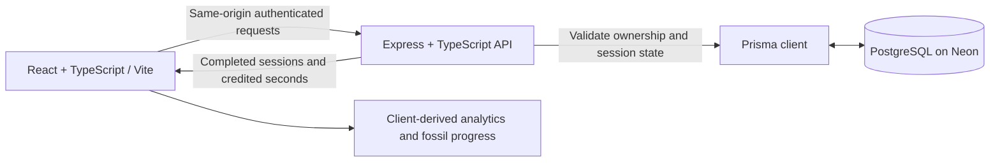

# DinoFocus current design

Updated November 4, 2026 for M4. This document describes the implemented app.
The [M1 proposal](M1-proposal.md) and [M2 design](M2-design.md) are historical records.
See [M4 scope and trade-off](M4-scope.md) for the decision to cut Groups.

## Product and scope

DinoFocus helps individuals start focused work, organize it by activity, review
their time, and collect fossils. The integrated personal workflow is:

1. Register or sign in.
2. Choose a preset or account-owned custom tag and countdown or stopwatch mode.
3. Start, pause/resume, reload to recover, then complete or cancel the session.
4. Review saved history, personal analytics, and cumulative fossil progress.

Groups, invitations, memberships, and shared weekly goals are removed from the
semester scope. Native mobile apps, OS/browser blocking, messaging, payments,
AI coaching, and advanced anti-cheat remain outside scope.

## Architecture

During development Vite proxies `/api` to the backend on port 3000. Authentication
uses an HttpOnly, SameSite=Lax cookie, with Secure enabled in production. Passwords
are bcrypt hashes; database login records store SHA-256 hashes of random cookie
tokens. Authentication routes have rate limits. Session and tag routes determine
the owner from the login cookie, never from a client-supplied user ID.

The browser redraws the timer once per second using server-computed elapsed time
anchored to the response receipt time. The server remains authoritative when
changing state or awarding credited seconds. No timer background worker is needed:
state transitions are validated when API requests arrive.

## Persisted records

The implemented models are in [schema.prisma](../backend/prisma/schema.prisma).

| Model | Main data and constraints |
| --- | --- |
| User | UUID, unique normalized email, password hash, created/updated timestamps |
| AuthSession | User relation, unique token hash, expiry; cascades when the user is deleted |
| FocusSession | User, tag name, mode, planned seconds, start/end timestamps, paused timestamp/seconds, credited seconds, status; at most one active session per user |
| Tag | User, display name, normalized name; unique normalized name within an account; cascades on user deletion |

Sessions store the tag's name as text, not a Tag foreign key. A saved session's
label therefore remains a snapshot. Tags currently support listing and creation;
renaming/deleting tags and editing history are not implemented.

There are no FossilProgress, RewardApplication, Group, Membership, or Invitation
tables. Fossil definitions and thresholds live in frontend source. The browser
derives museum state from the account's server-saved completed sessions.

## Session lifecycle and timing

The persisted statuses are `active`, `completed`, and `cancelled`. A paused session
is still active with `pausedAt` set. There is no separate failed status.

| Action or rule | Implemented behavior |
| --- | --- |
| Start | Validate mode, tag, and duration; create a server-timestamped session; reject a second active session |
| Countdown | Whole seconds from 60 to 86,400; complete after the planned focused duration; credit exactly that duration |
| Stopwatch | Complete after at least 60 focused seconds; credit server-computed elapsed time, capped at 12 hours |
| Pause/resume | Persist pauses and exclude break time from credited duration; completion/cancellation are allowed while paused |
| Complete | Validate server elapsed time and state; persist one result; repeated completion returns the saved result |
| Cancel | Persist a cancelled session with zero credit; repeated cancellation returns the saved result |
| Abandonment | On the next session API request, cancel countdowns older than planned duration plus two hours and stopwatches older than 12 hours, including pauses |

State updates compare the previously read `updatedAt` value before writing and
retry conflicts. The partial unique database index enforces one active session per
user. Unknown or another account's session IDs return 404. The client cannot set
the authoritative credit or timestamps.

## Frontend integration and recovery

`api/sessions.ts` wraps the authenticated session endpoints and converts responses
into the view data used by history, analytics, and the museum. All completed-history
pages are fetched, rather than silently limiting totals to the first 100 records.

The account workspace loads history and its active session on entry, including
after sign-in or reload. Navigation and tab focus do not automatically refetch
history. Successful actions update local view state from API responses. Failed
actions show an error and attempt to reconcile with the server; ambiguous network
failures do not trigger a fallback to local history. A 401 rechecks authentication.
Loading failures offer an explicit retry.

Account changes remount the workspace to avoid carrying another user's view state
forward. History saved in another tab/device becomes visible after reloading or
re-entering the account workspace; live cross-device synchronization is not implemented.

## Tags

The presets are Deep work, Studying, Reading, and Creative work. Signed-in users
can create additional account-owned tags in the Focus view. Names are trimmed,
limited to 1–40 characters, and deduplicated per account ignoring case. Repeated
creation returns the existing tag. A custom tag's name is sent with a new session.

## Fossils and museum

Twelve original decorative SVG fossils share a progressive reveal component and
animated gestures on museum hover, keyboard focus, and detail views. Motion is
disabled when reduced motion is requested. The museum supports search, collection
filters, favorites, and details. The animated fossil artwork is the only illustration
style; alternate field sketches and externally hosted illustrations were removed.

Unlocks use cumulative completed minutes; minutes are not spent. Thresholds are
15, 30, 45, 60, 90, 150, 210, 270, 360, 450, 600, and 750 minutes. Definitions are
configured in [fossils.ts](../frontend/src/data/fossils.ts), not through a user-facing
reward configuration API. The next specimen is chosen automatically; users do not
select a separate reward target or earn repeated copies after completion.

The server stores credited time, and completion is idempotent. Fossil progress is
derived from that history, so there is no separate reward write to duplicate or
keep synchronized. Browser rendering is not an authoritative reward database.

## Analytics

The dashboard derives daily and weekly totals, activity breakdowns, trends,
comparisons, streaks, personal goal views, and CSV exports from completed history.
Calendar boundaries follow the browser's local timezone; weeks begin Monday.
Sessions are credited to their completion date, including sessions crossing midnight.
Current-period comparisons use the corresponding elapsed part of the prior period.
The dashboard offers day/week views, not a dedicated month view or arbitrary-range API.

Museum favorites and personal analytics goal settings use account-scoped browser
storage and do not synchronize across devices. Sessions and custom tags do.

## API surface

| Area | Routes |
| --- | --- |
| Health | `GET /api/health` checks database reachability |
| Authentication | `POST /api/auth/register`, `/login`, `/logout`; `GET /api/auth/me` |
| Tags | `GET /api/tags`, `POST /api/tags` |
| Sessions | `POST /api/sessions`, `GET /api/sessions`, `GET /api/sessions/active`, `GET /api/sessions/:id` |
| Transitions | `POST /api/sessions/:id/pause`, `/resume`, `/complete`, `/cancel` |

See [API.md](../backend/API.md) for request/response shapes. There are no dedicated
analytics or fossil endpoints; these views use completed session records.

## Demo data and account history

The ordinary URL uses the real authenticated backend. The dedicated presentation
account `demo@dinofocus.example` was populated with 12 fictional sessions across
several days, totaling 149 minutes, and three custom tags. Its baseline has five
collected fossils; a real one-minute completion unlocks T. rex at 150 minutes.
Rehearsals change those totals. The creation script refuses to overwrite an existing
account and prints a generated password once; credentials are not committed.

`?demo=sample` is a separate no-login browser-local fixture. It starts with 120
fictional minutes and uses the `dinofocus.m2.sample.*.v3` keys. Reset affects only
that fixture. Account history never reads or imports legacy browser-local history,
and custom tag creation is unavailable in the sample workspace.

## Verification and remaining work

Local frontend build/lint and 24 frontend tests passed. Backend type-check/build,
44 session API integration tests, and three tag API integration tests passed in
this development session. These are named checks, not a claim that the full backend
suite or latest GitHub Actions run was verified. Database integration tests use an
isolated `test` schema. The demo account's login/history/tags APIs and browser
sign-in/history flow were checked; the one-minute unlock was rehearsed by the user.

Before presenting, verify both local services and database connectivity, confirm
the demo baseline, and rehearse the exact flow. Deployment, broad accessibility,
responsive/cross-browser review, and full regression verification remain release
work. The M1 plans for tag/history editing, separate failed states, monthly analytics,
repeat fossil copies, and a reward configuration UI are not implemented as written;
they must not be claimed as completed features.

AI assisted with implementation, tests, and documentation. The team remains
responsible for reviewing the code, product decisions, and presentation claims.
